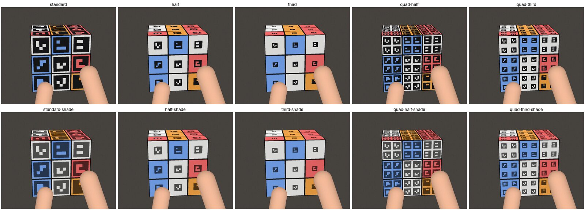

# フェーズ0追加検証: 色付き ArUco ステッカー

各ステッカーに色付き ArUco マーカーを貼り、色判定に頼らずにキューブの状態と回転を推定できるかを確かめる。
最初は**スマホのスロー撮影（240fps）で撮った動画を後から解析する**ために作り、いまは普通のプレイ（ライブ）でも使える。

ステッカーの符号（`src/aruco/codes.ts`）は 3 種類:

- **54 種類（3×3・マスごとに違う）**（推奨・`unique54`）: 自作の 3×3 ビットの 54 個。ID = 揃った状態での facelet 番号で、
  貼る場所と向きが決まっている（マーカーの上辺 = 揃った状態でのその面の「上」: U は B 側、D は F 側、側面は U 側）。
  1 枚のマーカーの ID と向きから面の真ん中の位置が分かるので、**センターや他のマスが指で隠れても面を組み立てられる**。
  印刷用 PDF は `docs/stickers/cubevision_unique54_stickers.pdf`（1 ページ目 16mm・2 ページ目 15mm、3 ページ目に貼り方と展開図。下の「マスごとに違う 54 種類」）
- **12 種類（3×3）**（`aruco12`）: 自作の 3×3 ビットの 12 個。ID 0〜5 = 面 U R F D L B のセンター以外、6〜11 = 各面のセンター。
  色は印刷して読みやすい明るい色（`PRINT_COLORS`）。印刷用 PDF は `docs/stickers/cubevision_aruco12_stickers.pdf`
  （`node scripts/aruco-stickers.mjs` で作る。下の「ステッカーの符号の比較と決定」）
- **54 種類（4×4）**（`aruco54`・最初に印刷した版）: `DICT_4X4_100` の ID 0〜53（ID = 面番号×9 + 位置 = facelet 番号）

- 本体アプリの「ArUco」の画面（コードは `src/aruco/`、画面の入口は `src/ui/ArucoScreen.tsx`）。初めて開いたときに読み込む
  （本体の起動は重くならない）。他の画面に移っても解析と結果は残る。以前の `aruco.html` は本体の ArUco の画面へ移動するだけのページ
- 解析はすべて端末内（Worker）。動画はどこにも送らない
- 2 つのモード
  - **キューブ**: ステッカーを貼ったキューブを回した動画から、見えている面を組み立てて手順を推定する（下の「キューブモード」）
  - **テスト**: シート（テストページ・ステッカーのシート）を写した動画で、方式 × 色 × 大きさの検出率を出す

## 開き方

- **スマホだけで**: 本体（`https://hsgwyuki0429-design.github.io/cube/`）の上のメニューの「ArUco」。
  `…/cube/#aruco` か、以前の `…/cube/aruco.html` で直接開ける
- PC で開発するとき: `npm run dev` → `http://localhost:5173/#aruco`。
  スマホから PC のサーバーに: `npm run dev:lan` → `https://<PC の IP>:5173/#aruco`
- ArUco の画面から開いたときは、カメラを自動で起動しない（裏で追跡が動くと解析が遅くなる）。カメラが動いていれば、止めるボタンを出す

iPhone で写真アプリから動画を選ぶと、Safari が動画を変換（圧縮・スロー再生の動画に書き出し）することがある。
「ファイル」アプリに保存してから「ブラウズ」で選ぶと元のまま読める。ファイルの fps が 30 前後に出たら、「実際の撮影 fps」に 240 を入れる。

## 普通にプレイする（ライブの追跡・スキャン・タイマー）

本体のメインの画面（フリー・タイマー）は ArUco 専用（2026-10 に普通の色のステッカー・ステッカーレス・手の検出を削除した）。対応するステッカーは
**54 種類 `unique54` の 4 個・幅 1/2 だけ**（`STICKERS`、`src/aruco/design.ts`。設定では選ばない。ArUco の画面のキューブモードも同じ）。

- 認識の入口（`processFrame`、`PipelineConfig.stickers`）で、マーカーから面を組み立てる
  （`src/vision/arucoFrame.ts` → `src/aruco/cube.ts`）。各セルの色は ID から決まる面（12 種類は ID÷6 の余り、54 種類は ID÷9）の代表色の Lab（`src/aruco/palette.ts`、白・赤・緑・黄・橙・青）
  にして `FrameResult` で返すので、観測器・デコーダ・スキャン・精密解析・タイムの判定は色の読みと同じ形で動く
- 代表色は固定なので、揃ったキューブならスキャンなしで「揃った状態から開始」できる。崩れたキューブは 6 面スキャン
- マーカーは小さいので、認識の解像度は長辺 1280 以上・切り出し（ROI）なし（精密解析だけ直前のマーカーの周りで検出する `arucoRegion`）
- 30fps のカメラでは回している途中はぶれて読めないが、層が止まった瞬間に読めれば追える（デコーダは観測が飛び飛びでも仮説で埋める）。
  `tests/arucoLive.test.ts`（30fps・2.5 手/秒・ぶれ付きの合成）で、ライブの追跡と精密解析が 8 手すべて正しい
  （12 種類も同じ。`tests/arucoLive.test.ts`）
- デモ: `?demo` の合成キューブにもマーカーを描く（`SyntheticCube` の `aruco`・`design`。OpenCV なしで描く）。`npm run e2e` で、スキャン → 30 手の
  追跡（正答率 100%）とタイマーの流れが通る
- **実物の動画（手持ち・暖かい照明・18mm を貼ったステッカーレスのキューブ）で分かったこと**:
  - 印刷した薄い青・緑は暖かい照明の下で灰色・黄緑に写り、色の照合で正しいマーカーの青 92%・緑 69% を捨てていた
    （正面が見つからず「キューブが見えていません」）。12 種類の色の照合は、2 ビットの読み違いで入れ替わりうる ID（距離 2 の
    4 組: 白–赤・緑–白センター・緑–橙センター・赤センター–黄センター。`CONFUSABLE12`）の色に見えたときだけ捨てる（`colorConsistent`）
  - 角をカメラに向けると上・横の面だけになり、正面のないフレームを捨てて 3D の動きが止まっては飛んでいた。ライブでは、正面に割り当たる
    面がなければいちばんカメラを向いた面を正面にする（`reconstructFaces` の `frontAlways`。キューブモードは今まで通り）
  - 3D の向きが 1 フレームだけ 90° 跳ねていた: 持ち替えの判定を待つ間、古い姿勢に新しい傾きを組み合わせていた（待つ間は動かさない）。
    見えている面が 1 面だけ（センターが隠れて 1 色）だと向きを 90° ごとに区別できないので、直前の 3D の向きに近い姿勢を選ぶ
    （`frameOrient` の `continuity`）。ぶれで数フレーム読めない間は、直前の回転の速さで 0.25 秒（最大 60°）まで回し続ける（`Cube3D`）
  - 録画のアプリが認識できなかったフレームのうち 68% で姿勢が取れ、30° 以上の飛びは 16 → 0 回（`tests/debug/realAruco.debug.test.ts`。
    画面の録画なので、認識できたフレームはアプリの重ね描きがマーカーを隠していて数えられない）
- 前のフレームから引き継ぐキューブの傾きは、面の割り当てには使わない。スキャンでキューブを回して面を見せ替える間に傾きの推定が狂い、
  それで正面を取り違えて、取り違えた傾きをまた引き継いで抜け出せなくなった（3 面目で止まった）。傾きは、いまの面の法線と合うときだけ
  格子の向きの決定に使う

## キューブモード

1. 揃った状態から回し始めた動画を選ぶ（最初の状態を揃った状態として推定する）。白を上・緑を正面に持つと、色基準の表記が普段の表記と同じ
2. 最後も揃った状態なら（T-perm を 2 回など）「最後は揃った状態」に印を付ける。最後の状態からも逆向きにたどって、より正確になる
3. 「解析する」。終わると推定した手順が出る。「正解の手順」を入れると比べる
4. 「動画で確かめる」で、組み立てた面（紫の枠）とマーカー、いまのフレームで組み立てた面の展開図、ここまでの手を見る。「次の手」で手の回し始めに飛ぶ
5. 3D キューブは**実際に回した速さと間で**動く（`src/aruco/timedCube.tsx`・`timeline.ts`）: 手 i は実時間の回し始め〜回し終わりに、
   cubing.js の再生位置（手ごとの開始・長さは indexer から）を比例で進め、手と手の間は前の手の終わりで止める。
   「推定した手順」では自前の再生ボタン（実際の速さ・1/2・1/4、スライダー）、「動画で確かめる」では動画の再生位置に合わせる
   （向きはその手のときの持ち方 = カメラから見た向き）
   - 手の時刻（`turnTimes`）: 回している途中の層は面として組み立てないので、観測の区切りだけでは回し始めと回し終わりがほぼ同じ時刻に
     なっていた（3D が一瞬で回る）。回した層の側面のマス（回している面そのものは格子ごと回るので使わない）で、回す前の色が 2 フレーム続けて
     見えた最後のフレームと、回した後の色が 2 フレーム続けて見えた最初のフレームの間を回していた時間にする（途中にたまたま 1 フレームだけ
     そろって見えるものを除く）。合成動画（1 手 75ms）で 63ms 前後

しくみ（`src/aruco/cube.ts`）:

- **面の組み立て**: マーカー 1 枚の 4 隅から、その面の平面の射影変換が分かる。その座標で「ほぼ同じ大きさの、軸にそろった正方形」が
  格子の間隔（マーカーの辺の 1.05〜1.9 倍、データから推定）で並ぶマーカーを同じ面とする。直交する面・回している途中の層は外れる。
  センター（12 種類は ID 6〜11、54 種類は ID÷9 の余りが 4）があればそれを真ん中に、なければ 3×3 に広がっているときだけ位置を決める
- **誤読を捨てる**: 読んだ ID の色と、写った色（マーカーの明るいセルの平均）が合わないマーカーは使わない（`colorConsistent`。白と黄・赤と橙・
  黄と橙は写り方で紛れるので合うとみなす）。12 種類の符号は誤り訂正の距離を取れない代わりに、取り違えやすい組を見分けやすい色どうしにしてあり、
  その組の相手の色に見えたときだけ捨てる（照明で色がずれた正しいマーカーを捨てない）
- **カメラフレームの面への割り当て**: 射影変換を分解して面の法線を求め（焦点距離は画像の長辺の 0.8 倍を仮定）、上・右・正面・下・左に割り当てる。
  面の格子の向き（どちらが行か）は、法線から推定したキューブの傾きのもとで 3D で決める。上から見下ろすと上面は縦に潰れて写るので、
  画像の上の角度で決めると 36° 回したところで 90° 側に丸めてしまう。傾きは次のフレームに引き継ぎ、上面しか見えないフレームでも向きを決める
- **手順の推定**: セルの色（ID から決まる面）を確かな観測にして、本体と同じオフラインのデコーダ（`decodeOffline`。揃った状態から前向き、
  最後が揃っていれば後ろ向きもつなぐ）で解く。見え方が 3 フレーム続いたら観測にする。斜めの面の小さいマーカーは
  フレームごとに読めたり読めなかったりするので、まったく同じ読みが続くことは求めず、読めたセルどうしが食い違わないフレームは
  同じ見え方として合わせる（同じ読みを求めると、合成の T-perm 2 回で後半の 1.3 秒の観測が出ず、7 手を見失った）。54 種類のステッカーの ID そのもの（同じ色のどのステッカーか）と
  センターの向きはまだ使っていない

## 1 列・1 枚の面、3 面の観測、検出の取りこぼし（ライブ・精密解析・キューブモード共通）

- **1 列（1×3・1×2）・1 枚（1×1）の面**（`reconstructFaces` の `partial`）: 3×3 に組み立てられない面も使う。位置は ID と向きで決まる符号
  （54 種類）なら 1 枚から、12 種類はセンター 1 枚（真ん中のマス = その面の色）だけ。3×3 の面で決めたキューブの傾きに対して、空いている
  カメラフレームの面の向きにほぼ一致するとき（約 25° 以内）だけ割り当てる。回している途中の層の側面は、回し始め・回し終わりの近く以外は外れ、
  回し終わりの近くなら回った先の面に割り当たる（動かし方で割り当ての向きが変わる）。外枠は推定（格子の間隔は同じフレームの 3×3 の面から）なので、
  3D の傾き（`estimatePose`）には使わない（`held`）。合成動画（T-perm 2 回）で面のあるフレームが 12 種類 628 → 734、54 種類 713 → 740（740 中）
- **3 面の観測**（`ARUCO_OBSERVER`。ライブと精密解析で同じ）: 観測器は上・横の面を読めたマス 3 つ以上、正面を 5 つ以上で観測に入れていた。
  ArUco は読めたマスの色が ID から確定するので、上・横は 1 マス・正面は 2 マスから入れる。60fps では安定を見る 2 フレームで見えている面の
  組み合わせが一致しないと観測を出さなかった（斜めの面のマーカーは読めたり読めなかったりする）ので、どのフレームにもある面で出す（`mergeSlots`）
- **12 種類の緑が読めない**: 緑（センター以外）の符号は明るいマスが 4 つ斜めに離れて並び、ぶれると枠が途切れて四角の候補にならないか、
  マス全体の多数決で暗いマスと読まれて捨てられていた（合成画像で緑 77%、他は 84〜95%）。
  - 二値化の窓を 3〜23 の 5 刻みで試す（3×3 の符号の既定。1280×720 で 25 → 35ms）。精密解析は 3〜33（`THOROUGH_PARAMS`）
  - OpenCV が捨てた四角を、マスの中心付近だけで読み直す（`rescueRejected`。明暗が符号どおりの割合 0.85 以上だけ）
  - 合成画像で全体 88% → 91%、緑 77% → 81%（精密解析の設定で 83%）、誤読は増えない。実物の録画で緑の検出 160 → 199 回
  - 暖かい照明の薄い緑は「白」と判定され、白のセンターの読み違いとして捨てていた。同じフレームの同じ色の仲間にごく近ければ使う（`supportedByFrame`）
  - それでも緑は他より読みにくい。気になるなら 54 種類（符号の形が違う）に貼り替える

## マスごとに違う 54 種類（`unique54`）

12 種類はセンターの符号で面の真ん中を決めるので、センターが指で隠れると、残りが 3×3 に広がっていない限り面を組み立てられなかった。
54 種類はステッカーごとに揃った状態の位置と向きが決まっていて、ピースと一緒に回るので、**どの状態でも**マーカーから見た面の真ん中の向きは
変わらない（角のマーカーなら斜め、辺なら内側に 1 マス: `centerOffset`）。面の組み立て（`layout`）で各マーカーが真ん中の位置に投票し、
多数決で決める（食い違うマーカー = 同じ色の別の ID への読み違いは外す）。一直線の 3 枚だけは面にしない（回している途中の層の側面のことが多い）。
4×4 の 54 種類（最初に印刷した版）も同じ決まりで貼っているので、同じように組み立てられる。

- **符号**: 3×3 ビットで回転対称でなく偶数個の明るいビットの符号は 60 通り。そこから 54 個（どの 2 つも距離 2 以上 = 1 ビットの読み違いは
  別の符号にならない）。距離 2 の組はなるべく違う色どうしに、紛れやすい色どうし（白–黄・赤–橙・黄–橙）は避けて割り当てた（焼きなまし。
  避けきれなかった組が 5 つ）。合成画像の比較（`tests/debug/markers.debug.test.ts`）で、正しく読めた割合は 12 種類とほぼ同じ 87.7%
  （4×4 の 54 種類は 81.7%）、誤読は 1.2%（12 種類 0.1%）。色で見抜けない同じ色どうしの誤読は 0.1%
- **色の照合**: 距離 2 の相手がほぼ全色にいるので 1 枚ずつは判定せず、同じフレームの他のマーカーと比べる（`frameColorFilter`: 読んだ色の仲間より
  別の色の仲間にずっと近いものを捨てる。照明で全体がずれても同じ色どうしは同じようにずれる）
- **偽の四角**: 符号の空きが少ないので、ステッカーの外側の色の縁ごと拾った一回り大きい四角も別の符号に読めてしまい、OpenCV は入れ子の外側が
  読めると内側の本物を試さない。マスの中心の明暗が符号どおりの割合（`fit`）が 0.85 未満なら、色の縁の幅だけ内側を自前で読み直す（`rescueInner`）。
  入れ子をまとめない設定（`minGroupDistance` を小さく）は本物まで読めなくなったので使わない
- 合成のキューブで、正面の真ん中と下の段を外しても正面の残り 5 マスを正しく組み立てる（12 種類は組み立てられない）。回す動画（240fps・T-perm 2 回）で
  面を組み立てられたフレームは 12 種類の 85% → 96%、28 手すべて正しい。ライブ（30fps）も精密解析も 8 手すべて正しい

## ステッカーの符号の比較と決定

「QR コードより今のマーカーがよいのか・他によいものはないか」の検討。センターの面さえ分かれば状態は決まるので、
ID は「色 6 × センターかどうか 2 = 12 個」で足りる。12 個なら AprilTag も選べるので、同じ合成画像で比べた
（`tests/debug/markers.debug.test.ts`。12 個のステッカーを大きさ 18〜40px（マーカーの辺）× 傾き 0/55/70° × ぶれ 0〜20% × 2 つの配色で描いて読む）。

| 符号 | 最小距離 | 正しく読めた（傾き 55°・ぶれ 10% まで） | 18px / 22px / 26px | 全条件 |
|---|---|---|---|---|
| 今の DICT_4X4_100 の 54 個（訂正 1） | 4 | 81.7% | 56% / 80% / 84% | 44.5% |
| AprilTag 16h5 から 12 個（訂正 2） | 6 | 84.4% | 58% / 87% / 89% | 47.2% |
| 自作 4×4 の 12 個（訂正 2） | 6 | 85.1% | 62% / 85% / 89% | 47.9% |
| **自作 3×3 の 12 個（採用）** | 2 | **88.6%** | **65% / 88% / 94%** | **53.9%** |

（明るい配色。濃い配色でも順位は同じ: 79.7 / 83.1 / 84.6 / 88.2%）

- **QR コード**: 最小の版（21×21 マス）でもマスが 4×4 の ArUco の 3 倍以上細かく、ステッカーの大きさでは読めない。使わない
- **AprilTag**: 同じ 4×4 でも、12 個に絞ると距離 6 で 2 ビット直せる。今の 54 個より少し良いが、同じ 4×4 の自作の 12 個と同じくらい
- **3×3**: マスが 4×4 より 2 割大きく（枠を含めて 5×5 マス）、小さく写ったとき・ぶれたときに一番読める。9 ビットでは 12 個に
  距離 3 を取れない（誤り訂正なし）。誤読（全条件で 3.2%）は、距離 2 の組をすべて見分けやすい色どうしにしてあるので、
  色の照合でほとんど捨てられる（読んだ色と写った色が同じ誤読は 0.2%）。同じ色のセンターとそれ以外は距離 3 以上で、
  センターは面の真ん中にあることでも確かめる
- **明るい色**: 黒いマスとの差が大きいほど読める（とくにグレー方式で赤・青）。印刷は明るく薄めの色（`PRINT_COLORS`:
  白 `#fafaf8`・赤 `#ff6e6e`・緑 `#78dc87`・黄 `#ffec6e`・橙 `#ffaa46`・青 `#7dafff`）。写った色の判定（`classifyColor`）でも
  6 色とも正しく分かれ、緑・青は他の色と合わない
- ステッカーは外側に辺の 8% の色の余白（黒い枠とキューブの黒い部分を分ける）。センター以外の 8 枚は位置も向きも自由に貼れる
  （54 種類はステッカーごとに位置と向きが決まっていた）
- **色の余白は外さない**（`tests/debug/stickerMargin.debug.test.ts`）。黒い本体のキューブで余白をなくすと、マーカーの黒い枠が
  本体の黒や隣のマーカーの枠とつながって四角として見つからず、読めたマーカーが 76% → 0% になった（余白 4% でも 76% → 54〜74%）。
  ステッカーレス（マスが色の板）では見つかるが、面への組み立てが崩れた（正しいマス 77% → 40〜52%。15mm）
- 印刷用 PDF のステッカーは隙間なく並べ、切る位置はブロックの外側の目印で示す（境目に線を引くと、切りずれたときに線が残る）

印刷用 PDF（A4・3 ページ）: 18mm × 2 セット・15mm × 2 セット・黒地のテストページ（12 種類 × 12/15/18mm、貼り方の説明つき）。
PDF を画像にして 150dpi・100dpi で全ページのステッカーを正しく読めることを確かめている（`tests/debug/stickerPdf.debug.test.ts`）。

## 不確実性の保持（読んだステッカーの照合・マスごとの確からしさ・再認識）

特定できないマスは無理に決めず、確からしさを付けて持ち、見えたら読み直す。ライブ・精密解析・キューブモード共通。

- **読んだステッカーをデコーダで照合する**（54 種類・4×4 の 54 種類）: これまでは ID から色だけを取り出していた。3×3 のピースは色の
  組み合わせで区別できるので、仮説の状態（54 枚の色）から各マスにあるステッカーの身元も決まる（`src/cube/stickers.ts` の `stickerIdAt`。
  ステッカーを 3D で動かした結果と一致することを `tests/stickers.test.ts` で確かめている）。観測に読んだ ID を載せ（`FaceObservation.ids`）、
  色は合うのに仮説ではそこに別のステッカーがあるときは 1 手と同じコストを払う。揃った状態で正面だけが見えているとき、F は色では
  見えない（正面は緑のまま）が、ステッカーの並びで分かる。観測器は同じ色の別のステッカーに変わったときも観測を出す（`idConflicts`）
- **マスごとの確からしさ**（`TrackerEngine.cellBelief`、`TrackUpdate.cells`）: キューブ固定のマスごとに
  - certainty: 有力な仮説（コスト差 3 以内、差に応じた重み）のうち、最良の仮説と同じステッカーがあると見る割合。0.9 未満は「未確定」
  - seenAt: そこにいまあるステッカーを最後に直接見た時刻、movedAt: 最後に動かした手の時刻。見た後に動いたものは「推定」
  （動かした手が直接見えていない・見えていない面に移った）

  正面だけが見えているとき、F とキューブごとの回転（z）は ID を読んでも区別できない。最良は F（1 手）だが、正面のマスは未確定のまま
  にしておき、上の面が見えた時点で F に決まる（`tests/arucoLive.test.ts`）。F で動いて見えていない右・下・左の 9 マスは推定
- **読みの確からしさ**（`readConfidence`）: マーカーのマスの中心の明暗が符号どおりの割合（fit）から 0.4 / 0.7 / 1。合成画像（指・ぶれ・180 場面）
  で、誤読 22 枚のうち 20 枚が fit 0.95 未満、正しい読みは 93% が 0.95 以上だった。確からしさの低いマスは観測のコストを下げる
  （1 枚の誤読で手を足さない）
- **真ん中が決まらない面は作らない**: 54 種類の面の組み立てで、面の真ん中への票も広がりも同じ候補が 2 つあるとき（読み違いと本物が
  1 枚ずつ）、どちらかに決めつけずに面にしない
- **再認識**（`src/aruco/reread.ts`）: 組み立てた面の読めなかったマスを、切り出して拡大し（マス 110px）、二値化の窓を細かく試して読み直す。
  読めた ID は、そのマスにあるはずの位置と向き（54 種類は ID と向きから面の真ん中が分かる）と合うときだけ使う。追跡が未確定・推定と
  みているマス（`focusCells`）から先に、ライブは 1 フレーム 4 マスまで・精密解析は全部。合成画像（`tests/debug/reread.debug.test.ts`）で:

  | マスの間隔 | ぶれなし | ぶれ約 3° | ぶれ約 6° |
  |---|---|---|---|
  | 90px | 84.7% → 86.9% | 79.5% → 86.7% | 67.4% → 73.6% |
  | 65px | 84.0% → 87.7% | 85.2% → 87.4% | 60.7% → 71.9% |
  | 45px | 79.3% → 80.2% | 78.3% → 81.7% | 57.8% → 64.0% |

  （見えている 3 面のマスのうち正しく読めたもの。誤りは増えない。全部読み直すと 1 フレーム +20ms ほど）

## 色による補完

マーカーはビットが鮮明でないと読めないが、ステッカーの色（マーカーの黒い枠のすぐ外側の色の縁）は、少しぶれても指が少しかかっても残る。
組み立てた面のうち、再認識でも読めなかったマスの色を測り、弱い観測として補う（`src/aruco/colorFill.ts`。ライブと精密解析。
キューブモードはまだ使わない）。

- **色を測るのは黒い枠のすぐ外側だけ**（`ringClass`）: マーカーの各辺（4 個の配置は 4 個 × 4 辺）に沿って 5 点ずつ、枠の外側の縁の幅の
  真ん中の点と、すぐ内側の黒い枠の太さの半分の点を組にし、内側が暗く（外側の明るさの 0.6 倍以下）外側が明るい組だけを使う。指は黒くないので、
  指のかかった所は内側も明るくなって使われない。マスの位置と大きさは組み立てた面の格子とマーカーの辺（`VisibleFace.marker`）から求める
- 辺ごとに使える点の色の中央値をフレームの色に分け、2 辺以上が同じ色で、ほかの色の辺の 2 倍以上あるときだけ（指の縁が枠と縁の間を
  通った辺は指の色になりうるが、数で負ける）
- 以前はマスの内側 8〜92% の明るさの上位 35% から肌らしい点を除いた中央値で測っていた。**実物で指の色が拾われた**: 暖かい照明の指は
  肌らしい色の範囲（`skinLike`）から外れ、印刷の橙は写ると肌に近いので、指に覆われたマスが橙・赤・黄に読まれていた
- **そのフレームで読めたマーカーの色を基準にする**（`frameRefs`: 色ごとの写った色味の中央値。色味 = 各チャンネルを最大のチャンネルで割った値）。
  照明で色がずれても、同じフレームの同じ色のステッカーは同じようにずれる。そのフレームにない色には寄せない
- いちばん近い色に十分近く（色味の距離 0.16 以下）、2 番目の色との距離の比が 1.8 以上のときだけ。肌らしい色は不明のまま（決めつけない）
- 補ったマスは色だけ（ID は分からない）で、確からしさ 0.5（読んだマーカーの半分のコスト）

合成画像（`tests/debug/colorFill.debug.test.ts`、指・ぶれ・遠さの 30 場面、見えているマス 563）で、色が分かったマスと誤り。
指の色は肌らしい色と、橙に近い色（`FINGER=240,160,70`。暖かい照明の指の代わり）:

| | 補完なし | 以前の補完（明るい点） | 黒い枠のすぐ外側 |
|---|---|---|---|
| 今の配置・全体 | 59.0% | 66.3% | **71.4%** |
| 　指に 〜50% 隠れた | 22.9% | 49.3% | **62.1%** |
| 　指に 50%〜 隠れた | 0% | 0% | **13.4%** |
| 　橙に近い指: 誤り | 0 | **95** | 0 |
| 4 個・幅 1/2・全体 | 54.5% | 58.3% | **61.5%** |
| 　指に 50%〜 隠れた | 8.2% | 8.2% | **26.8%** |
| 　橙に近い指: 誤り | 1 | **46** | 2 |

（指がかかっても枠の一部と縁が見えていれば測れるので、以前より多く分かる。`tests/colorFill.test.ts` に橙に近い指のテスト）

## ID なし追跡

マーカーの ID が読めなくなったマス（指が一部にかかった・少しぶれた）に、直前のフレームで同じマスに読めていたステッカーの ID を引き継ぐ
（`src/aruco/idTrack.ts`。ライブと精密解析）。

- **同じマス**: 組み立てた面の格子で求めたマスの中心（マスの輪郭）が、前のフレームのそのマスの中心からマスの間隔の 0.3 倍以内。150ms より
  前のフレームからは引き継がない
- **読めない理由があるマスだけ**: そのマスの色が分かっていて（色による補完）引き継ぐステッカーの色と合う、または指がかかっている
  （肌らしい点が 15% 以上）。30fps では回している層のマーカーはぶれて読めないが、格子は本体から求めるのでマスの位置は動かない。
  理由なしに引き継ぐと、回した後のマスに前のステッカーを置いてしまう
- **引き継がない**: 同じ面の読めたマスのステッカーが前のフレームと食い違う（見えないうちに層を回した）、色が合わない、回している層のマス
  （回転途中の形状認識の層を渡したとき）
- 引き継いだ ID は弱い観測（確からしさ: 読めたマスから 0.7、フレームごとに 0.85 倍、0.3 未満で切れる）。色で補ったマスに引き継ぐと、
  色だけだったマスにステッカーの身元が加わる

合成（`tests/idTrack.test.ts`）: 指が正面を横切る 30fps の 16 フレームで、ID が正しいマスが 90 → 101、誤りは増えない。途中で R を回しても
回した後のマスに前のステッカーを置かない。30fps で 8 手回す間に親指と横切る指が動く 4 場面（`tests/debug/idTrack.debug.test.ts`）で、
見えている 3 面のマスのうち ID が正しく分かったマス 68.5% → 71.3%（誤りは追跡なし 299・あり 296。追跡なしでもある誤りで、
指で正面がほぼ隠れたときの面の割り当てなど）、ライブの手順はどちらも 4 場面とも正しい。

キューブモードでは使わない（240fps では、止まっている間の読みは観測の中でフレームをまたいで合わせているので、引き継ぐ必要がほとんどない）。
後ろのフレームからの引き継ぎ（前後フレーム）は、精密解析のデコーダの後ろ向きの探索が担う。

## 回転途中の形状認識

層を回している途中（キューブが立方体の形でない）のフレームでも、読めたマーカーをすべて使って、回していない 2 層（本体）の姿勢と、
回している層・その角度を求める。各マーカーの 3D の位置・向き（カメラフレームに揃ったキューブの座標）も出す（`src/aruco/turn.ts`）。

1. **本体の姿勢**: 組み立てた面から PnP（`estimatePose`）。回している層の外側の面（R を回しているときの R の面）もマーカーどうしは
   そろっているので面として組み立てられるが、格子が本体から回っている。全部の面・1 つ外した面・面 1 つずつ・直前のフレームの本体の姿勢を
   候補にし、マスの位置と向きにごく近く（マスの間隔の 0.12 倍以内）合うマーカーがいちばん多いものを選ぶ
2. **層と角度**: 6 つの外側の層 × 角度 θ（3° 刻み → 0.5° 刻み）の仮説で、**すべてのマーカー**を「回っていないマス」か「回ったマス」の
   どちらかで説明する（マーカーの中心の射影と、マーカーの 4 隅から求めた法線）。回したマスの方がはっきり合う（0.1 マス以上）マーカーが
   3 枚以上（2 枚ならずれがごく小さい）、回していないとしたときよりずれの合計が 0.3 マス以上小さいときだけ、回しているとする（決めつけない）
3. **どちらが本体か**: 姿勢を求めた側が回している層だったとき（正面を回していて、正面がいちばん大きく見えている）は、残りの 2 層が回って
   見える。その仮説も入れて、本体を 2 層の側に直す。間の層（S など）のマーカーが見えないと、F と B のどちらが回ったかは 1 枚のフレームでは
   区別できない（相対的な回転は同じ）。直前のフレームの本体の姿勢に近い方を選ぶ
4. **向きと量**: 形だけからは 90° ごとの区別がつかない（θ は -45°〜45°）。フレームをまたいで θ をつなぐ（`unwrapTurn`。同じ層で 45° 以上
   跳んだら 90° ずらす）と、回し始めからの角度・回した向きが分かる

キューブモード（ArUco の画面の動画解析）では、フレームごとの回している層と角度を「動画で確かめる」に出し（回している層のマーカーは橙の枠）、
推定した手と照らす（`checkTurns`: 手の回し始め〜回し終わりのフレームで見えた層をその手の持ち方でキューブの面に直し、向きと量を比べる）。
結果の表の「回している途中の形との照合」。

合成画像（`tests/arucoTurn.test.ts`）:

- 回していないフレームでは回している層を出さない
- R・U・F・L・D を 18°・31°・59° 回した途中: 層と角度（90° ごとを除いて）が 5° 以内（層のマーカーが 2 枚未満しか読めないフレームは
  「回していない」とする。L を 59°・D を 31° 回すと、層のマーカーは 1 枚しか読めなかった）
- 240fps 相当（90° を 12 フレーム、露光中に約 7° 動く）で R U' F2 を回すと、3 手とも回している層が推定した手と合い、R・U' は向きも合う
  （F2 は途中からしか見えず、半回転かどうかまでは分からないことがある）
- 露光中に 11° 以上動くと、回している層のマーカーはほとんど読めない（`tests/arucoCube.test.ts` の Sune は 1 手 3 フレームで、形が見えるのは
  数フレームだけ）。スロー撮影（240fps）が前提

**追跡の手がかり**（本体の追跡・精密解析・動画の解析。ライブも既定で使う `arucoTurn`）:

- 認識（`turnSnapshot`、`src/vision/arucoFrame.ts`）がフレームごとに、いま見えている回転のつながり（層・回し始めからの角度・つながった
  フレーム数・最初に見えた角度・フレームの間の最大の変化）を `FrameResult.turn` で出す（80ms 見えなければつながりは終わり）
- エンジン（`TrackerEngine.push`）はそれをためて、つながりが途切れたか次の観測が出たときに 1 つの回転にまとめ（`turnHint`）、観測に
  `turns`（面のスロット・90° 単位の量か、量の分からない軸だけ）として付ける。量を出すのは、回し始めの近く（25° 未満）から 3 フレーム以上
  見えていて、フレームの間の変化が 30° 未満（90° ごとのつなぎ方を誤らない）、回し終わりが 90° の倍数から 25° 以内のときだけ。45° に
  届かなければ何も出さない
- デコーダ（`src/track/decoder.ts`）は、仮説の姿勢で面のスロットをキューブの軸に直し、展開する手の並びの軸ごとの回転（軸の正の側の層を
  負の側に対して）と照らす: 量が合わなければ +0.6（`turnCost`）、量の分からない軸でその軸の手がなければ +0.4（`turnAxisCost`）。
  90° が見えたら、同じ向きの 90° か半回転なら合う（半回転は途中で立方体の形を通るので、見えた回転が途切れることがある）。
  手を安くはしない（手順の知識と同じ考え方: 手を足して説明する方が安くなるのを避ける）。後ろ向きに解くときは次の観測の手がかりを
  逆向きにする（`reversedObservations`）
- 色だけでは R と R' を見分けられない観測で、層の回る向きから正しい方を選ぶ（`tests/turnHint.test.ts`）。120fps・spread 0.05 の合成
  （`tests/debug/arucoEval.debug.test.ts` の C）では、R → 時計回り、U' → 反時計回り、L・D' → 軸だけ（回し始めが見えない）、F2・B → なし
- 仮説ごとにマスの射影を先に求めておく（`placeStickers`）。マーカーごとに求め直していた間は 1 フレーム 30ms（4 個の配置は 80ms）
  増えたが、いまは数 ms
- 30fps のライブでは、回している途中はぶれてほとんど読めないので、手がかりはほとんど出ない

**回している途中の層を別のブロックにする**（本体の認識。実物で、U を回している途中に正面の格子が上の列に引っ張られてずれていた）:

- 面を組み立てるとき、外側の 1 列（行）のマーカーだけが残りの 2 列の格子からずれていれば（角のずれがマーカーの辺の 0.15 以上、本体は
  0.08 以下で、その 3 倍以上）、その列を別の格子にし、面の格子は本体の 2 列だけで当て直す（`splitLayer`、`src/aruco/cube.ts`）。
  7〜11° くらいの小さな回転はこれで分かれる（それより回すと層のマーカーは格子の許容から外れて、面に入らない）
- 形状認識で回している層が分かれば、層が通る面の外側の 1 列を、観測した本体の格子に、姿勢から射影した「回した面」と「回していない面」
  の関係を掛けた格子で置く（`applyTurnLayers`、`src/vision/arucoFrame.ts`）。面に入らなかった層のマーカーも、形状認識で層のマスに
  置けたものはその列に入れる（確からしさ 0.7）。隠れて読めなかったマスも、その列にあれば層の格子で置く（同じ列のマスと一緒に動いたと考える）
- 読み直し・ID なし追跡・指の判定はマスごとの格子（`cellH`）で行い、層のマスは色で補わない（傾いて動いている面で縁の位置が確かでない）
- 回転途中の合成画像（U・U'・R・D・L'・F × 0〜36° の 8 段階 × 2 視点 = 96 枚、4 個・幅 1/2）で、色が正しいマス 1945 → 2000、
  誤ったマス 101 → 32（誤りの多くは、ずれた格子で色を補っていたマス）。`tests/layer.test.ts`

## 円環図（廃止）

マスごとの確からしさを、層ごとの円に並べて見る図（jagarikin さんの「円でできたルービックキューブ」の図と同じ考え方）を、フリーの画面と
「動画で確かめる」に出していたが、2026-10 に廃止した（コードも削除）。

## マーカーの配置の比較（大きさ・4 個・色の面積）

ステッカー（18mm）の大きさは変えず、中のマーカー（黒い枠を含む模様）の大きさ・個数・暗いマスの色を変えた 10 案を、
指で隠れたときのマスの認識率と、人に見える色で比べた（`src/aruco/design.ts`・`tests/debug/stickerDesign.debug.test.ts`）。
印刷用 PDF は `docs/stickers/cubevision_unique54_designs.pdf`（1 ページ目が全案の見本、2 ページ目から 1 案 1 ページ・54 枚。16mm）。比較の数字は 18mm で測った。
**どれを使うかは実物で試してから決める**。本体の認識は今の配置と「4 個・幅 1/2」に対応した（下の「4 個・幅 1/2 の認識」）。

| 案 | マーカー（ステッカー 18mm） |
|---|---|
| 現状 | 1 個・辺 0.84（約 15mm） |
| 1 個・幅 1/2 | 1 個・辺 0.42（約 7.5mm）・真ん中 |
| 1 個・幅 1/3 | 1 個・辺 0.28（約 5mm）・真ん中 |
| 4 個・幅 1/2 | 2×2・辺 0.40（約 7.2mm。2×2 に収まる最大: 外側の縁 0.06・間 0.08）。同じ ID・同じ向き |
| 4 個・幅 1/3 | 2×2・辺 0.28（約 5mm） |
| ＋濃い同色 | 上の 5 案それぞれで、暗いマス（枠を含む）を黒でなくステッカーの色 × 0.35 にしたもの |

**方法**: 54 種類（`unique54`）の符号で、崩した状態・ランダムな向き・視点のキューブを 1280×720（ライブの認識と同じ長辺）で描き、
指（肌色の帯、幅はマスの 0.75〜0.95 倍）を「持ち方どおり」（正面の下の角に親指・上の面の手前に人差し指・横の面に中指）か
「ランダム」に置く（なし 20%）。見えているマス（向き 0.25 以上）ごとに、指に隠れた割合（ステッカーの 9×9 点）と、
そのマスの中で正しい ID が読めたか（4 個の案はマスの中の多数決）を数える。同じ 180 場面をすべての案で描く。
距離は正面のマスの間隔 90・65・45px（1280 で約 24・33・46cm）、露光中のキューブ全体の回転（ぶれ）0・約 3°・約 6°。
検出はライブと同じ設定（max(RGB)、`ArucoBench` の既定）。

**結果**（180 場面・見えているマス 3,425）:

| 案 | 隠れ 0% | 〜25% | 〜50% | 〜75% | 遠い 45px | ぶれ 3° | ぶれ 6° | 誤り/千マス | 印刷色の面積 | 離れて見た色の差 ΔE |
|---|---|---|---|---|---|---|---|---|---|---|
| 現状 | **99.5%** | 41.7% | 0% | 0% | **99.2%** | **96.6%** | **83.2%** | 7.3 | 42% | 27.7 |
| 1 個・幅 1/2 | 97.0% | **92.5%** | 7.5% | 0% | 91.6% | 80.6% | 12.1% | 7.9 | **86%** | **5.6** |
| 1 個・幅 1/3 | 76.8% | 78.3% | 18.8% | 0% | 41.6% | 22.8% | 1.9% | 4.4 | 94% | 2.4 |
| 4 個・幅 1/2 | 95.4% | **98.3%** | **91.3%** | 41.7% | 86.1% | 85.0% | 29.1% | 14.0 | 48% | 24.2 |
| 4 個・幅 1/3 | 79.8% | 80.8% | 72.5% | **48.6%** | 40.8% | 46.3% | 5.2% | 10.5 | 74% | 10.5 |
| 現状・濃い同色 | 99.2% | 42.5% | 0% | 0% | 98.3% | 92.0% | 78.1% | 6.4 | 42% | 24.1 |
| 1 個・幅 1/2・濃い同色 | 96.7% | 89.2% | 5.0% | 0% | 90.3% | 80.2% | 13.1% | 8.2 | 86% | 5.0 |
| 4 個・幅 1/2・濃い同色 | 94.0% | 96.7% | 88.8% | 38.9% | 82.4% | 78.9% | 20.4% | 15.2 | 48% | 21.3 |

（隠れた割合の列・遠い 45px はぶれなしの場面、ぶれの列は隠れていないマス。1 個・幅 1/3 と 4 個・幅 1/3 の濃い同色は黒とほぼ同じ。
75% より多く隠れたマスはどの案もほぼ 0%。「離れて見た色の差」は、マーカーの黒と印刷色を面積で混ぜた色と、無地の印刷色の ΔE76
（小さいほど人には無地のステッカーに見える）。6 色の見分けやすさ（混ぜた色どうしの最小の差）は現状 30・幅 1/2 34 で、小さくするほど
白–黄・赤–橙の差も広がる。全結果は `e2e-output/sticker-design/results.json`）

分かったこと:

- **指に強いのは 4 個・幅 1/2**。今のステッカーは指が 1 割でもかかると読めない（ArUco は 4 隅と全部のビットが見えている必要がある）。
  4 個なら半分隠れても 9 割読める。1 個・幅 1/2 も、縁にかかる程度（〜25%）なら 9 割読める
- **ぶれに強いのは今のステッカー**。マーカーが小さいほど 1 ビットが小さく、露光中に動くとすぐ読めなくなる（約 6° のぶれで現状 83%・
  幅 1/2 12%）。30fps のライブで持ち替えている間・回している間は、小さいマーカーはほとんど読めない見込み。
  スロー撮影（240fps、露光が短い）の解析なら差は小さい
- **遠さ**: 幅 1/2 はマスの間隔 65px（1280 で約 33cm）までは今と同じ、45px で 9 割。幅 1/3 は 45px で 4 割
- **誤り**: 4 個の案は 1 マスに 3 枚ほど読めるぶん誤読も多い（マスの中の多数決の後でも千マスに 14。現状 7）。色の照合で見抜けない
  同じ色どうしの誤読は千マスに 1〜2
- **人の見やすさ**: 幅 1/2 にすると印刷色の面積が 42% → 86% になり、離れて見るとほぼ無地のステッカー（ΔE 28 → 6）。
  4 個・幅 1/2 は面積が今とほぼ同じ（48%）。濃い同色は黒より少し色に見える（ΔE 28 → 24）が、ぶれに少し弱い（83% → 78%）
- 合成画像の結果。実物の難しさ（艶・ピント・印刷のにじみ・指の影）は入っていない。小さいマーカーほど印刷のにじみ・ピントの影響を受けやすい

### 4 個・幅 1/2 の認識（本体に組み込み済み）

本体のアプリが対応するのはこの配置だけ（`STICKERS`。`PipelineConfig.arucoDesign = "quad-half"`）。デモ・E2E の合成キューブもこの配置で描く。

- 1 枚のマーカーからは、ステッカーの 4 つのどこにあるかが分からない。同じ ID のマーカーを 1 枚のステッカーにまとめ（向きが同じ・
  ステッカーの中の 2×2 の並びの位置からマーカーの辺の 0.35 倍以内のものだけ。読み違えた同じ ID が格子をゆがめた）、並びからステッカーの
  中の位置を決める（斜めか 3 枚以上なら 1 通り、横・縦に 2 枚なら 2 通り）。全部のマーカーの隅からステッカーの射影変換を求め、
  「今の配置の 1 個の仮想のマーカー」（`virtualMarkers`。ステッカーの 0.08〜0.92 の四隅）にして、以降（面の組み立て・再認識・色で補う・
  ID なし追跡）は今の配置と同じに扱う
- 位置が決まらないステッカー（1 枚だけなら 4 通り）は、仮説ごとに格子を当てる。**半マスずれた格子も形の上では合ってしまう**（4 個の
  マーカーは半マスの間隔で並ぶ）ので、形では選ばず、マスごとに読んだ ID がどれだけ揃うか（多数派の ID の重み − ほかの ID の重み）で選ぶ。
  同点（位置の決まったステッカーの読みの確からしさも同じ）か 0 以下なら面を作らない
- 回転途中の形（`src/aruco/turn.ts`）は、マスごとにマーカーの 4 つの位置のどれかに合えばよい（`pointsOf`）。ID ごとにいちばん fit の
  よいマーカーだけを使う（`turnMarkers`）
- ゆるめた許容（間隔・向き）も試したが、読めるマスは増えず誤りが増えたので戻した

**総合評価**（`tests/debug/arucoEval.debug.test.ts`。合成、1280×720。色で補う・ID なし追跡まで入った本体の認識で比べた）

A. 1 フレーム: 崩した状態・ランダムな向き・距離（マスの間隔 90・65・45px）・指・キューブ全体のぶれ（0・約 3°・約 6°）の 60 場面、
見えているマス 998。色が正しく分かったマス（ライブの設定。精密解析の設定もほぼ同じ）:

| | 全体 | 指なし | 指 〜50% | 指 50%〜 | ぶれ 0 | ぶれ 約 3° | ぶれ 約 6° | 間隔 45px（指・ぶれなし） | 誤り |
|---|---|---|---|---|---|---|---|---|---|
| 今の配置 | **72.1%** | **96.3%** | 55.5% | 0% | 70.4% | 81.3% | **64.0%** | **96.1%** | 0.1% |
| 4 個・幅 1/2 | 62.2% | 72.9% | **67.7%** | **12.1%** | **79.5%** | **83.9%** | 16.5% | 75.0% | 0.3% |

（ぶれの列は指のある場面も含む。指・ぶれなしで間隔 65・90px なら、どちらも 97〜100%）

B. 30fps・2.5 手/秒・持つ指が動いてマーカーを隠しながら 8 手 × 5: ライブの追跡・精密解析とも、どちらの配置も 5/5 正しい。

C. 120fps（240fps のスロー撮影を 2 枚に 1 枚）・約 9 手/秒・回している層のぶれ・指、8 手 × 5 の精密解析: どちらの配置も、形状認識の手がかり
なし・ありとも 5/5 正しい（手がかりは今の配置 27 個・4 個の配置 13 個。4 個は小さいので回している途中の層が読みにくい）。この場面では
手がかりがなくても正しく読めていて、差は出なかった（色だけでは R と R' を見分けられない場面のテストは `tests/turnHint.test.ts`）

## 撮り方

- **スロー撮影（240fps）**: 露光が 1/240 秒以下になるので、回している途中のぶれが小さい。ArUco はビットが鮮明でないと
  読めないので、これがこの方式の前提
  - iPhone: 1080p/240fps は「高効率」（HEVC）でしか撮れない。HEVC は Safari か、ハードウェア復号のある端末の Chrome で開く
    （開けないときはページにそう表示する）
  - 写真アプリから共有・書き出しすると、30fps のスロー再生の動画に変換されることがある。そのときは「実際の撮影 fps」に 240 を
    入れると、時間（途切れの ms・速さ）を実時間に直す。元のファイル（AirDrop の「すべての写真データ」など）なら不要
- **明るさ**: 240fps は暗いと雑音が増える。窓際の昼光や明るい照明で
- **ちらつき**: 東日本 50Hz・西日本 60Hz の照明は 100 / 120 回/秒明るさが揺れ、240fps だとフレームごとに明るさが変わる。
  検出率がフレームごとにばらつくときはこれを疑う（ちらつきのない LED・昼光で撮り直して比べる）
- **距離**: スタンドで 20〜30cm。解析の画素数の目安は、結果の「px/セル」（マーカーの 1 セル = 辺の 1/6 の画素数）

### 撮るもの（順番）

1. テストページを止めて 3〜5 秒（大きさと色の比較の基本。12 種類は PDF の 3 ページ目、シートは「テストページ（12 種類）」）
2. テストページを手で振る・回す（回転の速さでの検出率。結果の「動きの速さ別」）
3. ステッカーのシート（18mm・15mm）を止めて（6 色の検出率）
4. ステッカーを貼ったキューブを持って回す（キューブモード）

**テストページは黒い紙やキューブの上に切り抜いて置く。** 合成画像で確かめたところ、白い紙の上では、赤・青のステッカーは
色の余白が周りの白より暗いため、余白ごと 1 つの枠として検出されることがある（辺が 1/0.84 倍になり、大きさの判定も崩れる。
グレー方式では読めないことも多い）。キューブの上では周りが黒い本体なのでこれは起きない。

## 結果の見方

- **区間検出率**: そのマーカーを最初に読めてから最後に読めるまでのフレームのうち、読めた割合。止まったシートなら全フレーム。
  途中で画面の外に出て戻ったときは、外にいた間も「読めない」に数える（画面に収めて撮る）。一度も読めなければ「読めず」
- **最長の途切れ**: 続けて読めなかったフレーム数と、読めた直前から直後までの実時間
- **px/セル**: マーカーの 1 セルの画素数（中央値）。どこまで小さくても読めるかの目安
- **コントラスト（グレー / max）**: 明るいセル（ステッカーの色）と黒いセルの差。グレーと max(R,G,B) で比べる。青・赤はグレーで小さい
- **動きの速さ別**: マーカーの移動の速さ（マス/秒、マス = 1 セル）ごとの検出率。56mm のキューブを 10 手/秒で回すと
  ステッカーは 150〜200 マス/秒ほど。読めなかったフレームの速さは、前後の読めたフレームの間の移動から出す
- **誤検出**: シートにない ID を検出した数（ステッカーのシートなら 54 以上など）
- **処理時間**: 1 フレームの前処理 + 検出 + 色の測定（方式ごと）。ライブではないので fps の合格ラインは使わない

合格ラインの目安（元の企画）: スタンド距離で 18mm 版が全色で区間検出率 90% 以上（表の「18mm 全色 90% 以上」）。

## 方式

| 方式 | 前処理 | パラメータ |
|---|---|---|
| a: グレー | グレースケール | OpenCV の既定 |
| b: max(RGB) | max(R,G,B)（HSV の V）。色付きのセルも明るく残る | 既定 |
| c: グレー+調整 | グレースケール | 調整版（下） |
| b+c: max(RGB)+調整 | max(R,G,B) | 調整版 |

調整版（`TUNED_PARAMS`、ページで JSON を書き換えられる）: 適応的二値化の窓 3〜43 を 4 刻み・定数 5、
`minMarkerPerimeterRate` 0.01（小さいマーカー）、`minOtsuStdDev` 3（弱いコントラスト）、
`perspectiveRemovePixelPerCell` 8、`perspectiveRemoveIgnoredMarginPerCell` 0.2、サブピクセルの角の補正。窓を細かく試すぶん 3〜4 倍遅い。
`polygonalApproxAccuracyRate` を 0.05 に緩めると、マーカーが密に並ぶキューブの上で読めるマーカーが 27 → 11 に減った（合成のキューブ。
シートでは差がない）ので緩めない。合成のキューブでは調整版より既定の max(RGB) の方が多く読めたので、キューブモードの既定は b。

## 判断したこと（選択肢と推奨）

1. **検出ライブラリ: OpenCV.js**（js-aruco2 ではなく）。このリポジトリが使っている `@techstark/opencv-js` 5.0 に
   `ArucoDetector`・`DICT_4X4_100`・`DetectorParameters` が入っていた（追加の依存なし）。前処理した 1ch 画像をそのまま渡せる
   （方式 b が素直に書ける）・パラメータを細かく変えられる・実績が多い。js-aruco2 は前処理を差し替えるのに手を入れる必要がある
2. **ライブではなく録画の解析**（ユーザーの判断）。そのため元の「中級スマホで 15fps 以上」は使わず、処理時間（ms/フレーム）を出す
3. **動画の読み込み: mp4box.js + WebCodecs**（依存を 1 つ追加）。`<video>` のシークや再生では全フレームを確実に取れない。
   サンプル表だけ読み、フレームのデータは復号するときに必要な部分だけ読む（数百 MB の動画でも全体を読み込まない）。
   縦向きの動画の回転（tkhd の表示行列）は、解析の前に表示の向きに直す（重ね描きと動画の表示が合う）
4. **テストページの ID と色の対応は決めつけない**。「白/赤/青 × 12/15/18mm（ID 90〜92）」の並びが ID ごとの色か大きさか
   分からないので、写った色（マーカーの明るいセルの平均）で色を決める。ID 0〜53 は仕様の色（ID÷9）
5. **同じ ID が複数の大きさで写るとき**は、写った辺の長さの比で大きさを決める（全部の大きさが写ったフレームで 1mm の画素数を
   求め、他のフレームは近いフレームの値と直前の位置で割り当てる）
6. **方式は 1 つの Worker で順に**当てる（前処理は使い回す）。方式ごとに Worker を分けると速いが、スマホのハードウェア
   復号器の同時数に引っかかるおそれがあるのでやめた。速くしたいときは方式を絞るか、間引き・解像度を下げる
7. **キューブモードは揃った状態から始めた動画だけ**。崩した状態から始めるには最初の状態が要る（2 方向から見せて読む、など）。
   持ち替え・中層・2 層回しの表記はまだ出さない（デコーダはセンター基準の 18 手で解く）

## 処理時間の目安

合成動画（1280×720・600 フレーム）をヘッドレス Chromium（PC）で: 方式 a 約 23ms・b 約 28ms・c 約 85ms・b+c 約 92ms /フレーム。
4 方式で 2.5 秒の動画に約 140 秒。1080p はこの約 2 倍、スマホはさらに 2〜3 倍かかる見込み。

本体の精密解析（ArUco のステッカーで普通のプレイをしたとき）は、直前のフレームのマーカーの周りだけで検出する（`arucoRegion`。
マーカーの大きさの範囲は画像全体と同じ画素数。縁の近くに見つかったら全体でやり直す）。録画は長辺 1280 に縮める（以前は幅を合わせていて、
縦向きの映像では 1080×1920 だった）。Node での 1 フレーム（`tests/debug/refineProfile.debug.test.ts`）: キューブが画面いっぱい
182 → 167ms・半分ほど 106 → 77ms・縦向き 173 → 78ms。手順は以前と同じ。

## 公開（GitHub Pages）

既存の `.github/workflows/pages.yml` が main への push でビルドして GitHub Pages に公開する（本体アプリと同じ）。
本体の Service Worker は画面の移動を index.html で返すので、最初は `aruco.html` を本体と別のページにして横取りの対象から
外していた。それでも、それ以前に本体を開いた端末では古い Service Worker が本体を返し、検証ページが開けなかった。
本体に組み込んだので、本体が URL（`aruco.html`・`#aruco`）を見て ArUco の画面を開く（古い Service Worker が返した場合も、
新しい版に入れ替わった後の再読み込みで開く）。ArUco の解析 Worker（約 15MB）は事前のキャッシュに入れず、最初に使ったときにキャッシュする。

## 検証

- `tests/aruco.test.ts`: 12 種類・54 種類（3×3）の符号の性質（距離・色の組）と OpenCV の辞書との一致、印刷用スクリプトとの一致、フレームの中での色の照合、
  3D の再生の時間の対応、6 色の ID・向き・色の判定、max(RGB) のコントラスト、テストページの大きさの割り当てと集計、
  途切れ・速さ・誤検出・実時間への換算、動画の分解（ffmpeg がある環境のみ）
- `tests/arucoRender.ts`: 色付きステッカーの合成画像（露光中の移動によるぶれ付き）
- `tests/debug/stickerDesign.debug.test.ts`: マーカーの配置（大きさ・4 個・暗いマスの色）の比較。指（`fingers`）・キューブ全体のぶれ（`shake`）・
  配置（`design`）はレンダラ（`tests/arucoCube.ts`）のオプション
- `tests/arucoCube.test.ts` と `tests/arucoCube.ts`（ArUco ステッカーを貼ったキューブのレンダラ。ステッカーの ID と向きを駒と一緒に 3D で動かす）:
  静止した各状態・姿勢で面の ID が正しいこと（読めないマスはあっても、読めたマスは必ず正しい）、回している途中の層を外すこと、
  回す動画から Sune・T-perm 2 回（持ち替えた姿勢）を復元できること（12 種類でも）
- E2E: `tests/debug/arucoVideo.debug.test.ts` で合成動画（240fps、テストページを振る）、
  `tests/debug/arucoCubeVideo.debug.test.ts` でキューブを回す合成動画（240fps、約 10 手/秒、ぶれ付き）を作り、
  `npm run build && ARUCO_VIDEO=… node scripts/aruco-e2e.mjs` でページ全体を通す（結果は `e2e-output/aruco/`）。
  合成動画では 4 方式とも全色 99% 以上（実物の難しさ: 艶・照明・ちらつき・ピント・印刷の色は入っていない）
  キューブを回す合成動画（1280×720・240fps・T-perm 2 回を約 10 手/秒・ぶれと手の揺れ付き）は、最後の状態を教えない前向きだけでも
  28 手すべて正しく、推定の手もない（解析はヘッドレス Chromium で約 40 秒）。実物の難しさ（指で隠れる・艶・ピント）はまだ入っていない。
  12 種類も同じ（`ARUCO_SCHEME=aruco12` が既定。合成動画は `tests/debug/arucoCubeVideo.debug.test.ts` の `ARUCO_SCHEME`）で 28 手すべて正しい（約 32 秒）。
  テストページは PDF の 3 ページ目を画像にして振る動画で、4 方式とも全色 94% 以上
